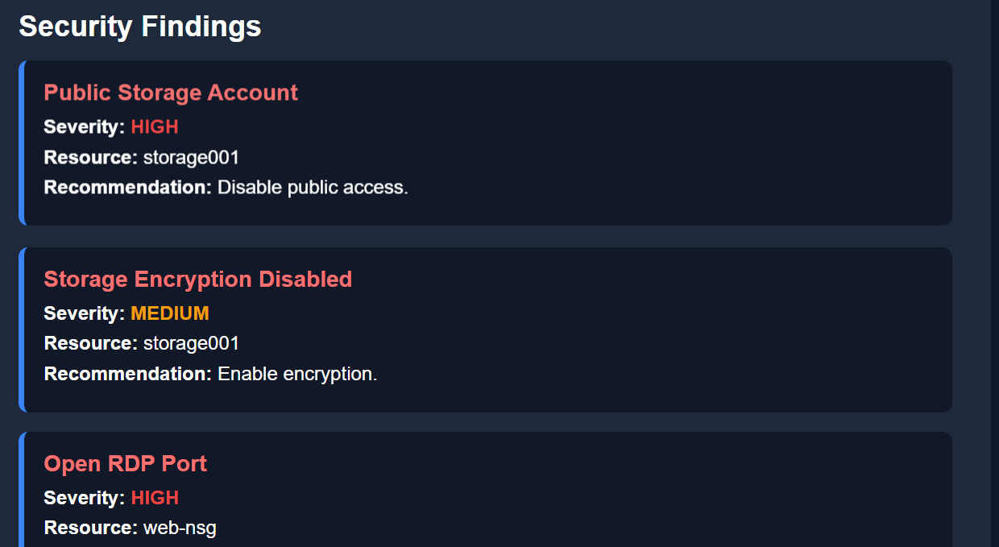
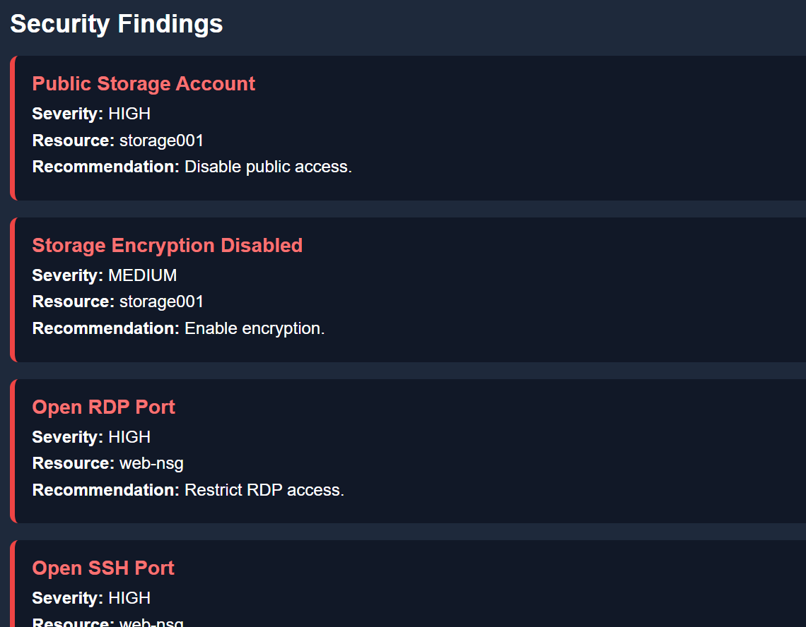
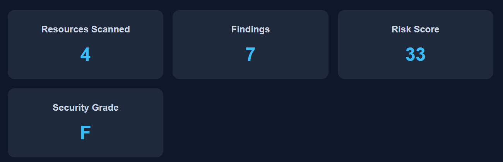
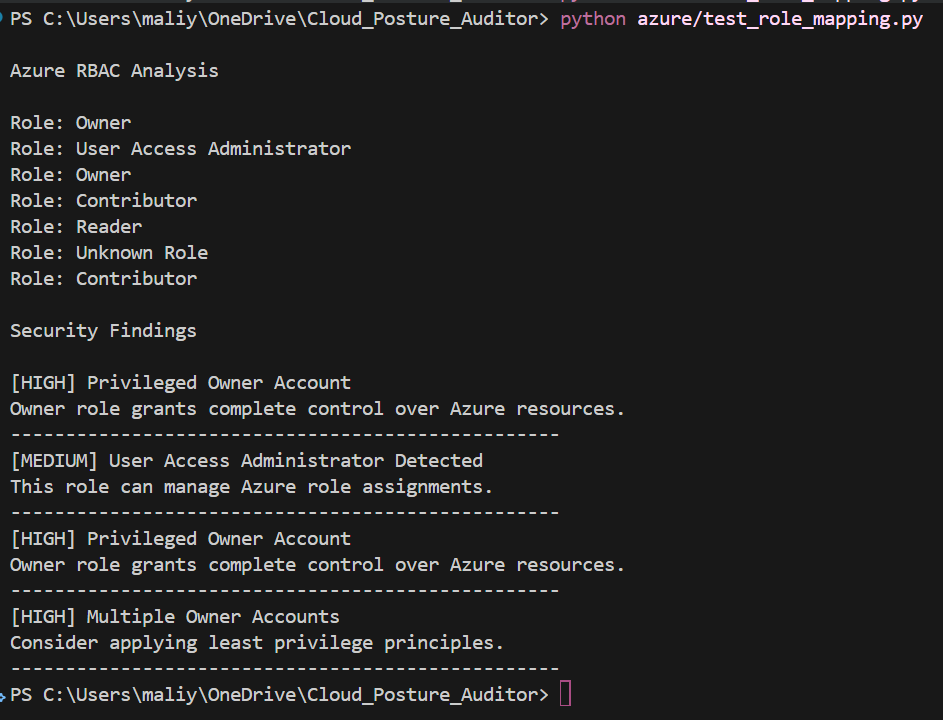
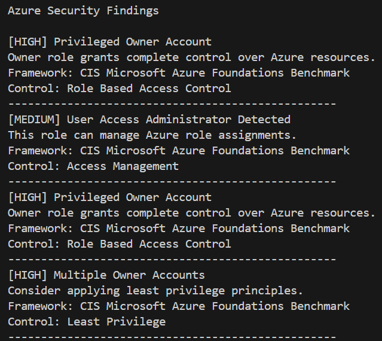
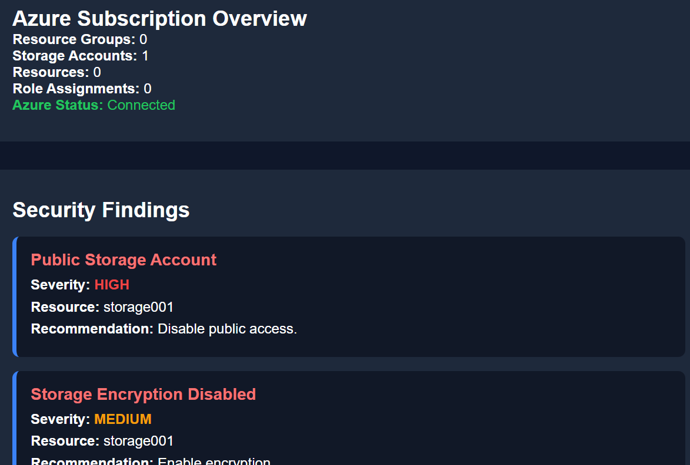
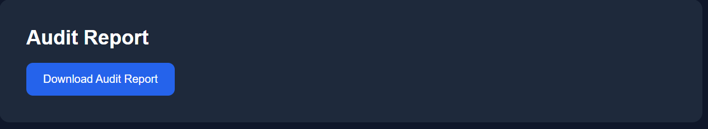
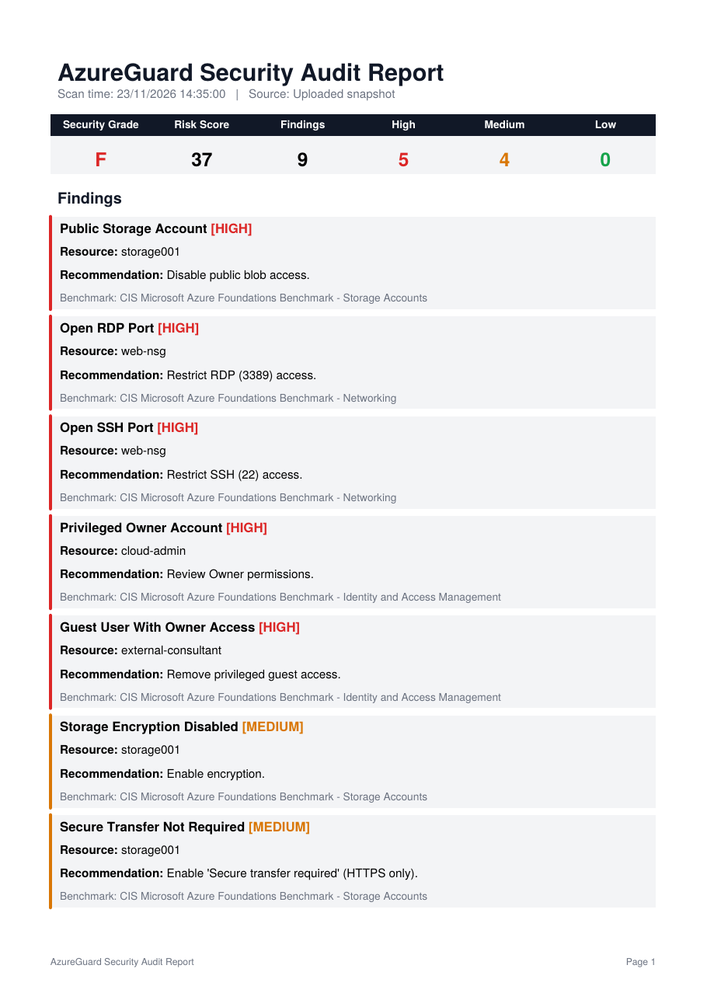

# Cloud Posture Auditor (AzureGuard)

A Python and Flask web app that audits a Microsoft Azure subscription for common security misconfigurations, maps findings to the CIS Microsoft Azure Foundations Benchmark, scores the overall risk, and produces a downloadable audit report.

> **Status:** Core features complete, with extra features planned in the Roadmap below. Built step by step on the `feature/azure-integration` branch and merged through pull requests.



## Features

- **Two ways to scan**
  - **Live Azure scan:** sign in through the browser and collect data straight from your subscription with the Azure SDK
  - **Snapshot upload:** upload a JSON snapshot of an environment (sample included)
- **Storage checks:** public blob access, encryption disabled, secure transfer (HTTPS) not required, outdated TLS version
- **Network checks:** reads every network security group rule and flags RDP (3389) or SSH (22) open to the internet, including port ranges, `*` and the `Internet` service tag
- **RBAC analysis:** converts Azure role IDs into readable role names and flags Owner, guest Owner and User Access Administrator assignments, plus more than 3 subscription Owners
- **CIS mapping:** every finding is linked to its area of the CIS Microsoft Azure Foundations Benchmark
- **Risk scoring:** weighted score (High 5, Medium 3, Low 1) converted to a grade from A to F
- **Dashboard:** severity counts, executive summary, subscription overview and finding cards with recommendations
- **Report export:** download the findings as a formatted PDF report (grade, severity summary and colour-coded findings) or as plain text
- **Automated tests:** pytest tests for the audit engine, scoring and web app, using the sample snapshot (no Azure account needed)

## Tech stack

| Area | Tools |
|------|-------|
| Backend | Python, Flask |
| Cloud | Azure SDK for Python (`azure-identity`, `azure-mgmt-resource`, `azure-mgmt-storage`, `azure-mgmt-authorization`, `azure-mgmt-network`) |
| Frontend | HTML, Jinja2, CSS |
| Reporting | ReportLab (PDF) |
| Testing | pytest |
| Cloud account | Azure for Students |

## Project structure

```
Cloud_Posture_Auditor/
├── app.py                  # Flask routes: dashboard, upload, live scan, report
├── auditor.py              # Security checks
├── scoring.py              # Risk score and grade
├── analytics.py            # Severity counts
├── report_generator.py     # Text report
├── pdf_report.py           # PDF report
├── azure_integration/
│   ├── auth.py             # Azure sign-in
│   ├── collector.py        # Resource groups, resources, storage, roles, NSGs
│   ├── snapshot_builder.py # Builds the live snapshot
│   ├── role_mapper.py      # Role ID to role name
│   ├── nsg_rules.py        # Checks NSG rules for ports open to the internet
│   ├── rbac_auditor.py     # RBAC findings
│   └── cis_mapper.py       # CIS benchmark mapping
├── scripts/                # Command-line checks against a live subscription
├── tests/                  # pytest tests
├── templates/index.html
├── static/style.css
├── sample_data/azure_snapshot.json
├── .env.example
└── screenshots/
```

## Getting started

### Requirements

- Python 3.10 or later
- An Azure subscription (only needed for live scans)

### Install

```bash
git clone https://github.com/Maliyka-L/Cloud_Posture_Auditor.git
cd Cloud_Posture_Auditor
python -m venv venv
venv\Scripts\activate        # Windows
# source venv/bin/activate   # macOS / Linux
pip install -r requirements.txt
```

### Configure

Copy `.env.example` to `.env` and add your Azure subscription ID:

```
AZURE_SUBSCRIPTION_ID=your-subscription-id-here
FLASK_DEBUG=0
```

`.env` is in `.gitignore`, so your subscription ID is never committed.

### Run

```bash
python app.py
```

Then open http://127.0.0.1:5000 in your browser.

### Try it without Azure

Choose **Upload Snapshot** and select `sample_data/azure_snapshot.json`. It contains a deliberately insecure environment, so you can see findings, the risk score and the report straight away.

### Live Azure scan

1. Make sure `AZURE_SUBSCRIPTION_ID` is set in `.env`
2. Select **Connect To Azure** on the dashboard
3. Sign in with your Azure account in the browser window that opens

The app only reads from your subscription. It does not create or change any resources.

### Command-line checks

The `scripts` folder has small scripts for checking each part of the live collection on its own. Run them from the project root:

```bash
python -m scripts.check_connection
python -m scripts.check_storage_accounts
python -m scripts.check_network_security_groups
python -m scripts.check_rbac
python -m scripts.check_audit
```

### Tests

```bash
pytest
```

## Screenshots

| Audit engine | Risk scoring |
|---|---|
|  |  |

| RBAC findings | CIS mapping |
|---|---|
|  |  |

| Azure subscription overview | Report generation |
|---|---|
|  |  |

### Example PDF report

[View the example PDF report](sample_reports/azureguard_sample_report.pdf), generated from `sample_data/azure_snapshot.json`.



## Roadmap

- [x] Collect storage security settings (public blob access, HTTPS only, minimum TLS) in live scans
- [x] Show RBAC and CIS findings on the live dashboard
- [x] Move the subscription ID into a `.env` file
- [x] Automated pytest tests using the sample snapshot
- [x] Collect network security group rules from Azure
- [x] PDF report export
- [ ] Identify guest users via Microsoft Graph (needs Entra ID directory permissions)

## Part of my portfolio

This project is one of my cyber security portfolio projects. See my other work at [github.com/Maliyka-L](https://github.com/Maliyka-L).

## Licence

MIT. See [LICENSE](LICENSE).
